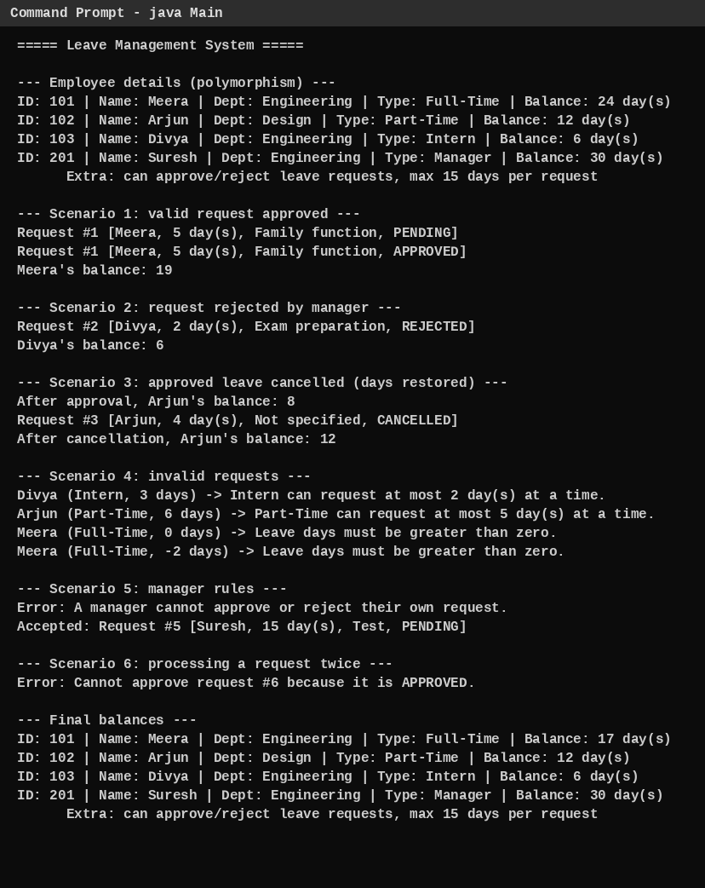

# Leave Management System

A Java console application that manages employee leave using Object-Oriented Programming principles.

**Prepared by:** Rakshitha L. S
**Repository:** https://github.com/Rakshitha017/Leave-Management-System

## Features
- Four employee types with different leave rules
- Apply, cancel, approve and reject leave requests
- Per-type limits on days per request
- Custom exception (`InvalidLeaveException`) for every rule violation
- Request status tracked with an enum: `PENDING`, `APPROVED`, `REJECTED`, `CANCELLED`

| Employee type | Annual leave | Max days per request | Extra rights |
|---|---|---|---|
| Full-Time | 24 | 10 | - |
| Part-Time | 12 | 5 | - |
| Intern | 6 | 2 | - |
| Manager | 30 | 15 | Approve / reject leave |

## Project structure
```
Leave-Management-System/
  README.md
  sample_output.txt
  docs/
    class_diagram.md        UML class diagram (Mermaid)
    refactoring_notes.md    what was improved and why
    sample_output.png       console screenshot
  src/
    Employee.java           abstract base class
    FullTimeEmployee.java
    PartTimeEmployee.java
    Intern.java
    Manager.java            can approve / reject requests
    LeaveRequest.java       one request + status transitions
    LeaveStatus.java        enum
    InvalidLeaveException.java
    Main.java               demo / test scenarios
```

## Build and run
Requires JDK 17 or later.
```
mkdir out
javac -d out src/*.java
java -cp out Main
```

## OOP concepts used
| Concept | Where |
|---|---|
| Encapsulation | Private fields in `Employee` and `LeaveRequest`; balance changed only through controlled methods |
| Inheritance | `FullTimeEmployee`, `PartTimeEmployee`, `Intern`, `Manager` extend `Employee` |
| Abstraction | `Employee` is abstract with `getEmployeeType()` and `getMaxDaysPerRequest()` |
| Polymorphism | `Employee[]` in `Main`; `validateRequest()` uses each type's own limit |
| Method overriding | Subclass rules; `Manager.displayDetails()` |
| Method overloading | `applyLeave(int)` and `applyLeave(int, String)` |
| Access modifiers | `private`, `protected`, package-private and `public` used deliberately |

## Class diagram
See [docs/class_diagram.md](docs/class_diagram.md).

## Results

### Test cases
| Test | Input / condition | Expected | Actual | Status |
|---|---|---|---|---|
| TC01 | Full-Time applies 5 days, manager approves | PENDING then APPROVED; balance 24 to 19 | As expected | Pass |
| TC02 | Intern applies 2 days, manager rejects | REJECTED; balance stays 6 | As expected | Pass |
| TC03 | Part-Time applies 4 days, approved, then cancelled | Balance 12 to 8, restored to 12 | As expected | Pass |
| TC04 | Intern applies 3 days | Rejected (limit 2) | Exception message | Pass |
| TC05 | Part-Time applies 6 days | Rejected (limit 5) | Exception message | Pass |
| TC06 | Full-Time applies 0 days | Rejected | Exception message | Pass |
| TC07 | Full-Time applies -2 days | Rejected | Exception message | Pass |
| TC08 | Manager approves own request | Rejected | Exception message | Pass |
| TC09 | Manager applies 15 days | Accepted | Request created | Pass |
| TC10 | Approve the same request twice | Second attempt rejected | Exception message | Pass |

### Sample output


Full text output: [sample_output.txt](sample_output.txt)

## Refactoring
Five improvements are documented in [docs/refactoring_notes.md](docs/refactoring_notes.md): shared validation, named constants, custom exception, status enum, and moving approval logic into `Manager`.

## Limitations and future work
- Data is kept in memory only (no database)
- Leave is counted in whole days (no dates, weekends or holidays)
- No login or roles beyond the `Manager` type
- Possible next steps: database storage, leave categories, GUI, JUnit tests
